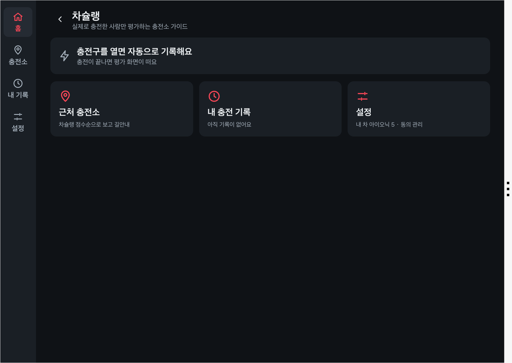
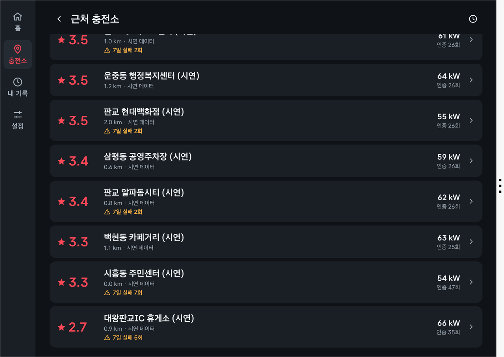
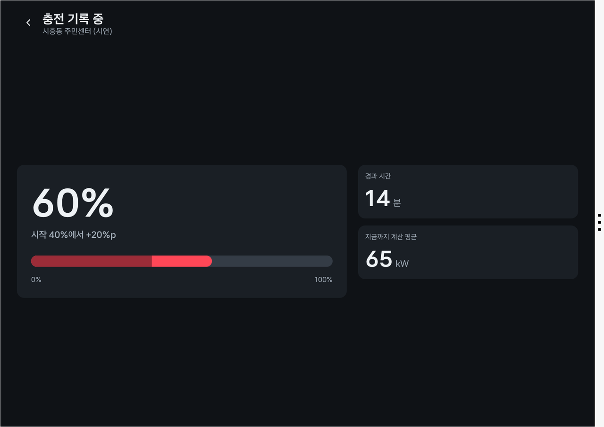
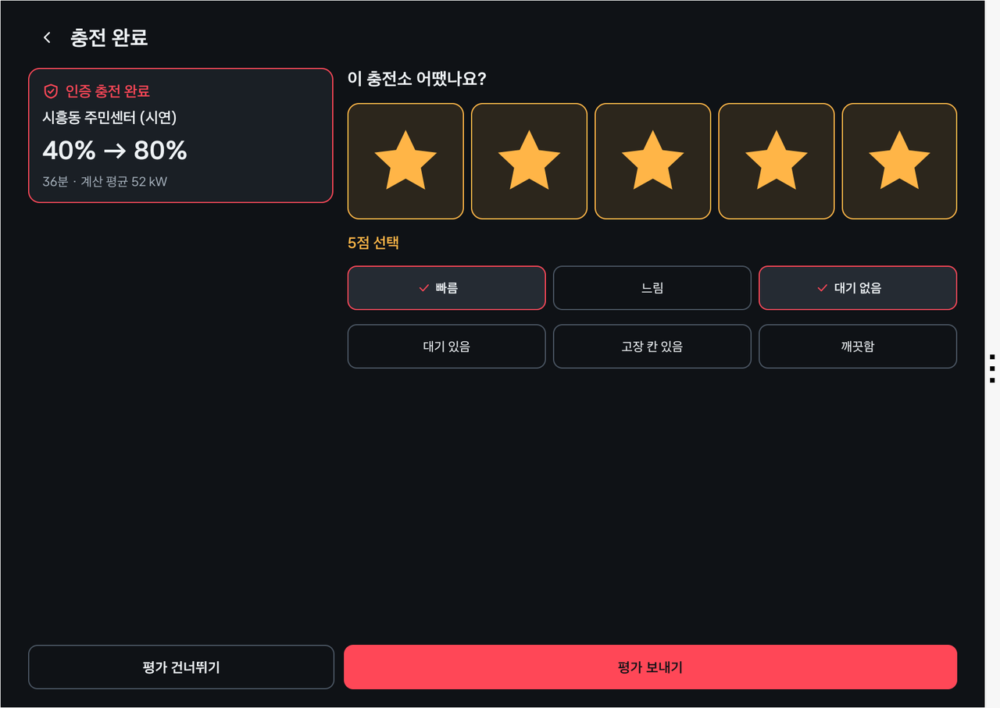
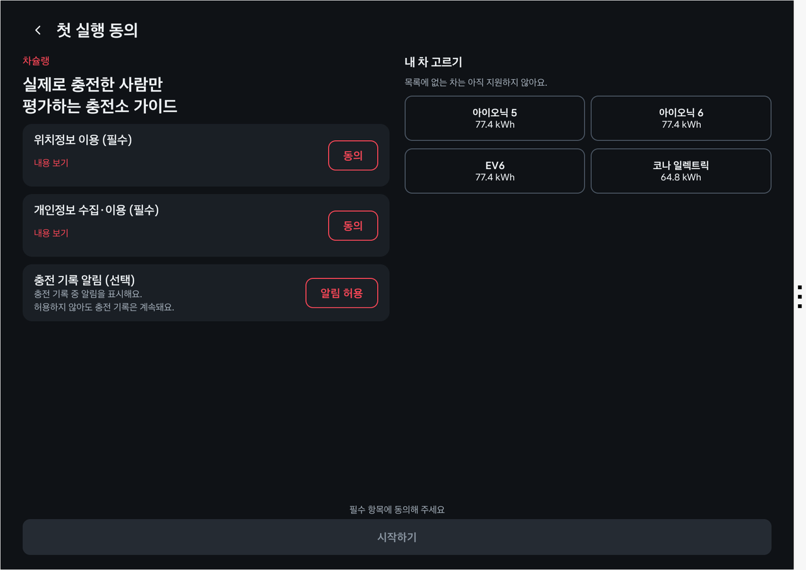
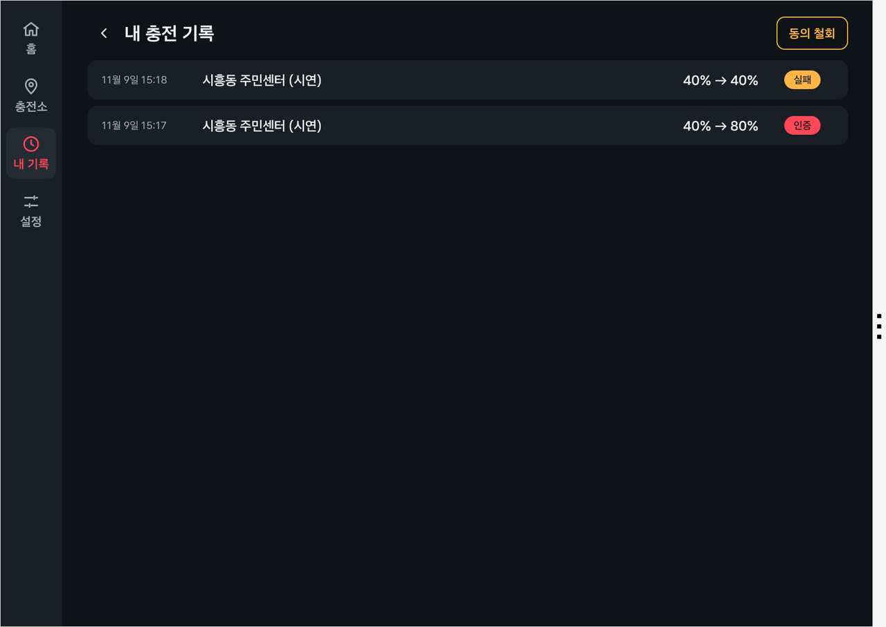

# 차슐랭 (Chachelin) — 앱 프로젝트 소개

<!-- 접수양식 02 파트 원문. tools/build-proposal-docx.py가 "## N." 절을 양식의 N번 칸에 넣는다. 실명·연락처·계정 정보를 쓰지 않는다. -->

## 1. 앱 한 줄 소개

충전구를 열고 닫는 순간을 차가 직접 기록해, **실제로 충전한 차만 충전소를 평가하고 충전 실패는 자동으로 기록되는** 전기차 충전소 평가 앱 — "차가 확인한 충전 기록으로 매기는 충전소판 미슐랭 가이드".

## 2. 기획 배경

### 불편한 순간: "사용 가능"이라던 충전기 앞에서

배터리가 20% 남은 퇴근길, 앱에서 "사용 가능"으로 보이던 급속충전기를 찾아갔는데 고장이거나 표시된 속도의 절반도 나오지 않는다. 다른 충전소를 찾아 다시 이동하는 사이 배터리와 시간이 함께 줄어든다.

### 숫자로 본 문제

- **가장 큰 불편은 고장이다.** GS차지비 이용자 1,400명 조사에서 가장 큰 불편은 잦은 충전기 고장(52.7%)이었고, 충전기 부족(47.0%)보다 앞섰다. (뉴스와, 2026-03)
- **충전기는 늘었지만 고르기는 더 어려워졌다.** 국내 충전기는 2021년 9만 4천 기에서 2025년 8월 41만 7천 기로 4.4배 늘었다. (쿠키뉴스, 2025-08) 선택지가 많아질수록 "어디가 실제로 잘 되는가"가 중요해진다.
- **기존 정보는 검증되지 않는다.** 지도 앱의 상태 정보는 충전 사업자가 보고한 값이고, 커뮤니티 후기와 고장 제보는 글쓴이가 실제로 충전했는지 확인할 방법이 없다. 고장 제보는 사용자가 따로 시간을 내야 해서 잘 모이지도 않는다.

### 왜 해결이 필요한가

충전소 정보의 신뢰가 낮으면 전기차 운전자는 여유 배터리를 크게 남기고 다니거나, 아는 충전소만 반복해서 쓴다. 이는 전기차의 실사용 편의를 떨어뜨리고 새로 늘어난 충전 인프라의 활용도도 낮춘다. **"실제로 충전한 차의 기록"**이라는 검증된 데이터가 필요하다.

출처
- 뉴스와(2026-03): https://www.news-wa.com/amp/automobiles/2026/03/20/20260320500025
- 쿠키뉴스(2025-08): https://www.kukinews.com/article/view/kuk202508070123

## 3. 앱 주요 기능 및 차량 특화 요소

### 핵심 기능

| ID | 기능 | 해결하는 문제 |
|---|---|---|
| F1 | **충전 자동 기록** — 충전구 열림 → 배터리 잔량(SoC) 변화 → 충전구 닫힘을 차가 기록 | 사용자 입력 없이 충전 사실을 확보 |
| F2 | **충전 인증** — SoC가 실제로 오르고 충전소 위치와 일치하면 "인증 충전" | 충전하지 않은 사람의 허위 리뷰 차단 |
| F3 | **평균 충전 속도 계산** — SoC 변화량 × 배터리 용량 ÷ 충전 시간 | 표시 출력과 실제 충전 결과의 차이를 드러냄 |
| F4 | **충전 실패 자동 기록** — 충전구를 열었지만 SoC가 오르지 않고 닫히면 "실패" | 고장 제보를 운전자 수고 없이 수집 |
| F5 | **3초 인증 리뷰** — 충전 직후 별점 + 태그 프리셋(빠름·대기 없음 등), 키보드 없음. 앱이 뒤에 있으면 결과 알림을 눌러 바로 평가 | 차 안에서 기억이 생생할 때 평가 |
| F6 | **차슐랭 점수와 길안내** — 평균 별점에 최근 충전 실패율을 반영한 점수순 목록(인증 충전 수·계산 평균 속도·최근 실패도 함께 표시), 선택하면 차량 내비로 바로 경로 설정 | 고르는 순간부터 가는 길까지 한 번에 |

### 왜 폰 앱이 아니라 차량 앱인가 (차량 특화 요소)

- **폰은 충전 사실을 모른다.** 배터리 잔량과 충전구 상태는 차만 아는 값이다. 그래서 차량 앱만 "충전한 차만 리뷰한다"를 보장할 수 있다.
- **평가 시점이 정확하다.** 충전이 끝나는 순간 운전자는 차 안에 정차해 있다. 그 자리에서 리뷰 화면이 뜨므로 평가가 자연스럽게 모인다.
- **고장 신고가 공짜다.** 충전 실패는 운전자가 아무것도 하지 않아도 차가 기록한다.
- **안전하다.** 모든 화면은 정차 중 전용이다. 주행 중 사용 선언(DO)을 하지 않아 주행 중에는 플랫폼이 앱 화면을 막는다.

### 차량에서의 새로운 경험

운전자는 평소처럼 충전만 하면 된다. 충전구를 여는 순간 기록이 시작되고, 닫으면 "인증 충전 완료: 20% → 80%, 32분, 평균 63kW" 카드가 뜬다. 내 충전 한 번이 다른 운전자에게는 검증된 충전소 정보가 된다.

### 기존 서비스와의 차이

| 서비스 | 하는 일 | 차슐랭과의 차이 |
|---|---|---|
| 충전소 정보 앱(이브이인프라 등) | 충전기별 상세 정보, 커뮤니티 후기·고장 제보 | 후기·제보가 실제 충전 여부를 검증하지 않음 |
| 티맵·카카오내비 | 충전소 검색, 실시간 상태, 길안내 | 상태는 사업자 보고값. 실제 충전 속도·실패율 없음 |
| 환경부 무공해차 통합누리집 | 전국 충전소 위치·상태 | 같은 한계. 출시 단계에서 이 데이터를 충전소 목록의 기반으로 활용한다(시연 빌드는 시드 충전소 10곳) |

## 4. 주요 사용 시나리오

**페르소나** — 전기차를 2년째 타는 30대 회사원. 집에 충전기가 없어 주 2회 공용 급속충전기를 쓴다. 고장 난 충전기 앞에서 30분을 허비한 경험이 있다.

**장면 1. 충전소 고르기 (정차 중)**
1. 퇴근길, 배터리 20%. 정차 후 차슐랭을 열면 근처 충전소가 차슐랭 점수순으로 보인다: "인증 충전 128회 · 계산 평균 68kW · 최근 7일 실패 0회".
2. 4.8점 충전소를 고르고 [길안내]를 누르면 차량 내비게이션에 경로가 바로 설정된다.

![충전소 상세 — 점수, 인증 충전·계산 평균·7일 실패, 최근 실패 시각, 별점 분포, 많이 받은 태그, [길안내] 버튼](images/ch-s2-detail.png)

**장면 2. 충전하고 평가하기 (충전 중 정차)**
3. 도착해 충전구를 열면 앱이 기록을 시작한다. 화면에는 배터리 잔량, 경과 시간, 지금까지의 계산 평균 속도가 보인다.
4. 충전구를 닫으면 인증 카드와 별점 화면이 뜬다. 별 5개, 태그 "빠름"·"대기 없음"을 누르면 끝. 키보드 입력은 없다. 충전하는 동안 다른 앱을 쓰고 있었다면 "충전 완료 · 3초 평가" 알림이 뜨고, 누르면 같은 화면이 열린다.

**장면 3. 충전 실패 (아무것도 하지 않아도)**
5. 다른 날, 다른 충전소에서 충전이 시작되지 않아 충전구를 닫았다. 앱이 "충전 실패를 기록했어요"라고 알린다. 이 충전소는 다른 운전자들에게 "최근 실패 1회"로 표시된다. 잘못 기록된 경우 [실패 아님]으로 취소할 수 있다.

![충전 실패 기록 — 충전구를 열었지만 배터리가 오르지 않은 시도를 자동으로 기록하고 알린다. [실패 기록 취소]로 되돌릴 수 있다](images/ch-s5-failure.png)

## 5. 개발 계획

### 구조

차량 앱이 Vehicle SDK와 NaviHelper로 충전 세션을 기록·판정하고, 결과만 서버로 올린다. 서버는 충전소별로 집계해 점수를 만들고, 앱은 그 점수로 목록과 상세 화면을 보여 준다.

| 구성 | 역할 |
|---|---|
| 차량 신호 모듈 | Vehicle SDK·NaviHelper 호출을 감싸고, 권한·지원 여부를 확인 |
| 충전 세션 기록기 | 충전구·SoC 변화로 세션을 만들고 인증/실패를 판정 |
| 서버(Supabase) | 충전 세션·리뷰 저장, 충전소별 점수 집계(SQL 뷰), 충전소 목록(시연: 시드 10곳 / 출시: 환경부 충전소 데이터 캐시) |
| 화면 | 근처 충전소, 충전소 상세, 충전 중, 리뷰, 실패 알림, 내 기록, 첫 실행 동의 (모두 정차 중 전용) |

### SDK/API 사용 계획

| 기능 | 용도 | SDK·API | 검증 상태(에뮬레이터 2.1.0) |
|---|---|---|---|
| F1·F2·F3 | 배터리 잔량(SoC) | Vehicle SDK `EvBattery` 리스너 | 수신 확인 |
| F1·F4 | 충전구 열림/닫힘 | Vehicle SDK `EvBattery` 리스너 | 수신 확인 |
| F2 | 현재 위치 | NaviHelper `getCurrentLocationInfo` | 수신 확인 |
| F6 | 차량 내비 길안내 | NaviHelper `requestRoute` | 동작 확인 |
| F6 | 충전소 목록·상태 | 공공데이터포털 한국환경공단 전기차 충전소 API(이용자 제한 여부·충전소 구분 포함) | **미연동.** 시연 빌드의 충전소는 서버 시드 10곳(판교 반경 3km). 출시 단계에서 서버가 수집·캐시 |
| F4(확장) | 충전 스위치 상태 | `EvBattery.getEvChargeSwitchState` | 조회 확인. 이번 제출의 판정에는 쓰지 않음. 다음 버전에서 실패 판정 보조 신호로 사용(아래 "기능 확장") |

### 판정 규칙

| 규칙 | 기준(초기값) |
|---|---|
| 인증 충전 | SoC 2%p 이상 상승, 충전 시간 3분 이상, 가장 가까운 충전소와 150m 이내 |
| 충전 실패 | 충전구가 열린 동안 SoC 상승 1%p 미만, 열린 시간 2분 이상, 충전소와 150m 이내. SoC가 오르지 않았다는 관측이며 고장 원인은 확정하지 않음 |
| 충전소가 아닌 곳 | 집 충전 등(150m 안에 충전소 없음)은 내 기기에만 기록하고 서버에 올리지 않음. 리뷰·점수에 반영하지 않음 |
| 공용이 아닌 충전소(출시 적용) | 환경부 데이터의 "이용자 제한"(입주민 전용 등) 충전소와 운전자가 등록한 집 반경 안의 충전도 같은 방식으로 기기에만 둔다. 외부인이 쓸 수 없는 충전기의 점수가 섞이지 않게 하고, 같은 차가 매일 같은 곳에 올려 거주지가 추정되는 일을 막는다 |
| 그 밖의 경우 | 충전구만 잠깐 연 경우처럼 인증도 실패도 아닌 세션은 기록하지 않음. 충전소 조회가 네트워크 오류로 실패하면 업로드 전에 다시 조회 |
| 계산 평균 속도 | SoC 변화량 ÷ 100 × 배터리 용량(kWh) ÷ 충전 시간(h). 충전 시간은 충전구가 열린 시간이라 충전기 출력의 실측값이 아님 |
| 차슐랭 점수 | 평균 별점 × (1 − 최근 30일 실패율). 실패한 운전자는 별점을 남기지 못하므로 실패율로 고장을 반영. 최근 30일 세션 5건 미만이면 감점 없음, 리뷰 5개 미만이면 "평가 중" |

### 개발 범위와 일정

| 기간 | 범위 |
|---|---|
| ~11/8 | 충전 세션 판정 + 단위 테스트, 충전소 매칭, 충전 중·리뷰·목록 화면, 서버 테이블 |
| ~11/12 | 서버 업로드, 길안내, 점수 집계, 나머지 화면 |
| ~12/2 (2차 PT) | 에뮬레이터 2대로 "다른 차의 기록이 내 화면에 반영되는" 시연 완성 |

### 개인정보와 운전 안전

- 서버에는 가명 처리한 차량 식별값과 충전소 ID만 보낸다. 정확한 주행 좌표는 저장하지 않는다. 충전소에서 일어난 충전(인증·실패)만 올리고, 집 충전 등은 기기에만 둔다. 출시 단계에서는 이용자 제한 충전소와 운전자가 등록한 집 반경의 충전도 올리지 않아, 반복 기록으로 거주지가 추정되지 않게 한다.
- 첫 실행 때 위치정보·개인정보 동의를 받고, 동의 버튼 외의 동작은 동의로 보지 않는다. 동의 전에는 기록하지 않는다.
- 동의를 철회하면 기록을 바로 멈추고, 서버에 올라간 그 차량의 기록을 즉시 삭제한다. 삭제 요청이 실패하면 성공할 때까지 다시 보낸다.
- 모든 화면은 정차 중 전용이며 주행 중에는 표시되지 않는다.

## 6. 기대효과 및 발전 가능성

### 사용자에게 주는 가치

- 운전자: 헛걸음 없는 충전소 선택, 실제 충전 속도에 근거한 판단.
- 현대자동차그룹: 충전 사업자는 자기 충전기의 세션 데이터만 갖고, 지도 앱은 사업자가 보고한 상태값만 받는다. **사업자를 가리지 않고 차량 쪽에서 본 충전 결과**(실제 들어온 kW, 충전이 시작조차 되지 않은 실패)는 차량 신호를 받는 차량 앱만 모을 수 있다. E-pit 운영 품질 지표, 블루링크·차량 내비의 충전소 추천, 전기차 경로 계획의 충전소 선택에 바로 쓸 수 있는 그룹 고유의 데이터 자산이 된다.
- 충전 생태계: 고장이 사용자 수고 없이 빠르게 드러나 복구가 빨라진다.

### 타깃 고객

- **1차 타깃**: Pleos Connect가 탑재된 현대자동차그룹 전기차 운전자 중 공용 충전기를 쓰는 사람. 집밥(가정 충전기)이 없는 공동주택 거주자가 핵심이다.
- **시장 규모**: 국내 전기차 누적 등록 약 89만 9천 대(2025년 말, 국토교통부). Pleos Connect는 2030년까지 글로벌 약 2,000만 대 탑재가 목표다.
- **탑재 전망**: 국내 첫 탑재 차종(더 뉴 그랜저 2026-05, 디 올 뉴 아반떼 2026-08)은 내연·하이브리드이고, 전기차는 제네시스 GV90 등 후속 차종부터 적용된다. 그 전까지는 (a) 하이브리드 차종의 연료량 신호(Vehicle SDK Fuel 도메인·AAOS `FUEL_LEVEL`, 에뮬레이터가 전기차라 미검증)로 같은 구조를 주유소 실주유 기록에 적용하는 방안을 검토하고, (b) 그룹 충전 네트워크(E-pit)의 운영 데이터와 연계해 점수의 기반을 먼저 쌓는다. 전기차 탑재와 함께 본 기능이 열린다.

### 예상 MAU

| 항목 | 값 | 근거 |
|---|---|---|
| 국내 전기차 신규 등록(2025) | 22만 177대(전년 대비 +50.1%) | 한국자동차모빌리티산업협회(KAMA) 2025년 결산, 파이낸셜뉴스 2026-01 |
| 현대차·기아 전기차 신규 등록(2025) | 약 11만 6천 대(기아 60,609 + 현대차 55,461, 합산 점유율 52.7%) | 2025년 결산 보도, 뉴스와 2026-02. 제네시스는 별도 집계를 확인하지 못함 |
| Pleos Connect 전기차 탑재 대수 | 탑재 차종이 그룹 전기차 전반으로 넓어진 뒤 1년 차 약 10만 대, 3년 차 약 30만 대 | 가정(연 11만 6천 대의 대부분이 탑재된다고 봄). 공개 수치가 나오면 교체 |
| 앱 설치율 | 20% | 가정 |
| 월 1회 이상 공용 충전 | 설치 차량의 70% | 집밥 없는 공동주택 거주 비율을 고려한 가정 |
| **예상 MAU** | **1년 차 약 1만 4천, 3년 차 약 4만 2천** | 탑재 대수 × 0.2 × 0.7 |

참고로 기존 충전소 정보 앱 이브이인프라의 MAU는 약 8만(2022-12)으로, 공용 충전 정보 수요가 충분히 크다는 근거가 된다. 차슐랭은 별도 설치가 아니라 차량에 탑재되므로 같은 수요를 더 낮은 획득 비용으로 가져온다.

### Retention

- **반복 행동에 붙어 있다.** 충전은 주 1~2회 반복된다. 충전구를 열 때마다 자동으로 기록되므로 앱을 따로 켤 이유를 만들 필요가 없다.
- **돌아올 이유가 있다.** "내가 평가한 충전소"의 점수 변화와 내 기록이 반영된 횟수를 보여 준다.
- **목표: 30일 Retention 50%.** 공용 충전을 주 1~2회 하는 운전자는 한 달에 4~8번 충전구를 열고, 그때마다 앱이 자동으로 기록·평가 화면을 띄운다. 즉 사용자가 "앱을 켜는" 결정 없이 한 달 안에 접점이 4번 이상 생기므로, 공용 충전을 계속하는 사용자는 자연히 활성 사용자로 남는다. 50%는 이 접점 빈도에 근거한 목표이며, 출시 후 실측으로 보정한다.

### 서비스 확대 계획

| 단계 | 내용 | 수익 |
|---|---|---|
| 1단계 | 운전자 무료. 인증 리뷰·계산 평균 속도·실패 기록 축적 | — |
| 2단계 | **현대자동차그룹 내부 활용**: E-pit 운영 품질 지표(충전소별 실제 평균 kW·실패율), 블루링크·차량 내비 충전소 추천과 전기차 경로 계획의 충전소 선택에 차슐랭 점수 반영 | 그룹 내 협업 |
| 3단계 | 지자체·환경부에 충전 인프라 품질 데이터 제공(보조금 충전기 사후 관리) | B2G |
| 4단계 | 충전 사업자(CPO) 대상 품질 리포트: 충전소별 계산 평균 속도, 실패율, 고장 의심 알림. 실패는 "SoC가 오르지 않은 시도"라는 관측이며 원인은 확정하지 않는다는 점을 리포트에 명시하고, 사업자가 직접 원인을 기록할 수 있게 한다 | B2B 구독 |
| 5단계 | 충전 비용 기록·혼잡 예측, 충전기 단위(같은 충전소 안 1번/2번 기) 평가 | 제휴 |

기능 확장(다음 버전)
- **음성 후기**: 3초 평가 뒤 하고 싶은 말을 음성으로 남긴다(음성 인식 STT). 키보드 없이 정차 중에도 안전하게 쓸 수 있고, 자유 입력에 섞일 수 있는 개인정보는 저장 전에 걸러 낸다.
- **충전 속도는 차량 기록으로**: 사람이 누르는 [빠름]/[느림] 태그 대신, 충전소 상세에 "이 충전소 계산 평균 kW vs 충전기 최대 kW"를 나란히 보여 줘 속도 평가를 차량이 계산한 값으로 바꾼다. 실차에서는 순간 충전 전력(AAOS `EV_BATTERY_INSTANTANEOUS_CHARGE_RATE`)으로 피크 kW도 함께 기록한다(에뮬레이터는 0으로 고정되어 시연하지 않음).
- **실패 판정 보조 신호**: 충전 스위치 상태(`getEvChargeSwitchState`)를 함께 봐서 "스위치가 켜졌는데 SoC가 오르지 않음"만 실패로 세고, 결제·인증 대기나 충전구만 열어 둔 경우처럼 스위치가 켜지지 않은 시도는 기록하지 않는다. 지금 코드가 이 값을 받고 있어 판정 규칙만 바꾸면 된다.
- **입주민 전용 모드**: 아파트 단지 충전기는 공개 점수에서 빼고, 같은 단지 입주민끼리만 고장·대기 정보를 보는 기능으로 분리한다.

출처
- 국내 전기차 누적 등록(쿠키뉴스, 2025-08): https://www.kukinews.com/article/view/kuk202508070123
- Pleos Connect 2,000만 대 목표·첫 탑재(머니투데이, 2026-04-30): https://www.mt.co.kr/industry/2026/04/30/2026042916243666820
- 이브이인프라 MAU(비즈워치, 2023-01): https://news.bizwatch.co.kr/article/mobile/2023/01/20/0019
- 전기차 누적 등록 89만 9천 대·2025년 신규 22만 1천 대(국토교통부 자동차 등록 현황, 세계일보 2026-01): https://www.segye.com/newsView/20260129517256
- 2025년 전기차 신규 등록 22만 177대·국산 57.2%(KAMA 2025년 결산, 파이낸셜뉴스 2026-01): https://www.fnnews.com/news/202601201405544489
- 기아 60,609대·현대차 55,461대(2025년 전기차 등록, 뉴스와 2026-02): https://www.news-wa.com/amp/automobiles/new-car/2026/02/19/20260219500065

## 7. 참고자료

- GitHub 저장소: 【제출 전 기입 — GitHub 저장소 주소】 (소스 코드 + apk/SamgakGorae_Chachelin_release.apk)
- 시연 영상: 【제출 전 기입 — 영상 링크 또는 첨부 파일명】
- 화면: 아래 화면은 제출 release APK를 Pleos Connect 에뮬레이터 2.1.0에서 실행해 찍은 것이다(충전소·기록은 시연용 시드 데이터).

- 시연 데이터 안내: 배터리 잔량은 에뮬레이터 콘솔로 주입한 값이다. 시연 빌드는 화면의 충전 시간·평균 kW에 시연 배속(×120)을 곱해 보여 준다(판정 기준에는 쓰지 않음). 충전소 목록(판교 반경 3km 10곳, 이름에 "(시연)" 표시)과 다른 차량의 충전 기록은 시연용 시드 데이터다. 환경부 충전소 API는 아직 연동하지 않았다.

## 8. 숏폼 링크

해당 없음
