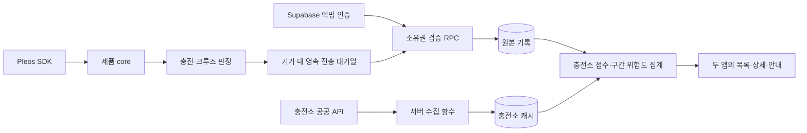
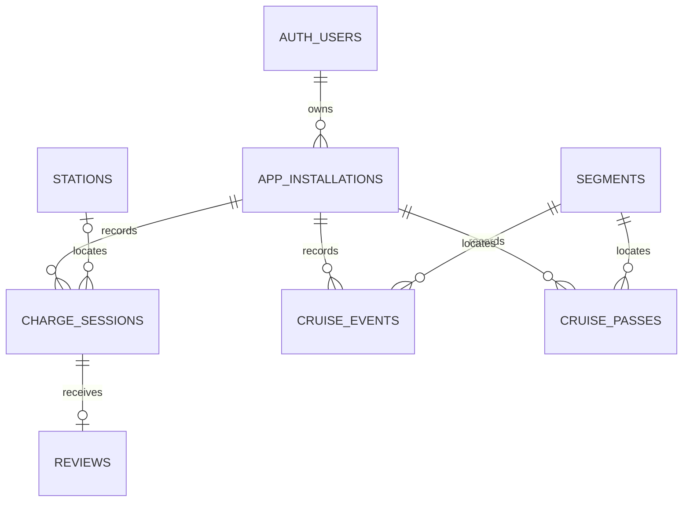

# 두 앱 공통 서버 스키마·서비스 흐름 초안

작성: 황준용, 2026-11-02. 기존 PRD, 크루즈 `docs/disengage-rules.md`, 차슐랭 PR #3의 저장소 계약을 기준으로 작성했다. **이 구조로 SQL migration 2개와 로컬 검증 15개를 작성했다. 원격 DB 생성·앱 연결은 아직 하지 않았다.** 배포 방법과 실제 구현 차이는 [deploy.md](deploy.md)를 따른다. 감점은 미구현이며 초기 조회 점수는 평균 별점이다.

## 1. 구성

Supabase 프로젝트 한 개에서 인증·PostgreSQL·HTTP API를 사용한다. 별도 상시 실행 API 서버는 초기 범위에 두지 않는다. 충전소 공공 API 수집과 Auth 사용자 정리처럼 비밀값이 필요한 작업만 Edge Function을 사용한다. 원본 테이블은 API 비노출 스키마에 두고, 필요한 읽기/쓰기 RPC만 API 노출 스키마에 배치하는 방향이다.

기록은 기기에서 판정하고 서버는 소유권·값 범위·중복·관계를 검증한다. 익명 인증은 접근 권한을 검증하는 수단이며, 실제 SDK 관측값임을 증명하는 장치는 아니다. 앱 재설치 시 같은 차량인지 판별할 수 없으므로 차량-일 통계는 실제로는 앱 설치 식별자-일 통계다.

## 2. 테이블 관계

`auth.users`는 Supabase 관리 테이블이며 별도 회원 프로필 테이블은 만들지 않는다. 나머지 7개가 앱용 테이블이다. 시드 설치 행은 실제 Auth 사용자 없이 관리 작업만 생성한다.

실제 migration에는 앱 테이블 외에 `charge_retractions`(계측값 없는 실패 정정 영수증)와 `migration_versions`(적용 버전) 두 내부 관리 테이블도 포함한다. 정정 요청이 업로드보다 먼저 도착해도 존재하지 않는 세션 정정은 성공으로 처리하고 후속 업로드를 막는다.

### app_installations — 앱 설치·소유권

| 필드 | 타입·제약 | 의미 |
|---|---|---|
| id | uuid PK | 서버가 발급하는 앱 설치 ID |
| owner_user_id | uuid FK auth.users | 로그인한 소유자. 관리자가 만든 시드만 null 허용 |
| app | text CHECK | CHACHELIN / CRUISEBREAKER |
| vehicle_hash | text | 앱의 기존 무작위 vehicleId를 앱별로 가명화한 키. 원본 UUID는 저장하지 않음 |
| state | text CHECK | ACTIVE / REVOKED |
| data_source | text CHECK | LIVE / SIMULATED / SEED |
| consent_version | text | 해당 설치가 동의한 문구 버전. 버전 문구는 별도로 확정 필요 |
| consented_at, revoked_at | timestamptz | 서버가 기록하는 동의·철회 시각 |

- 무작위 차량 UUID를 안다는 것만으로 설치를 소유하거나 삭제할 수 없다. 소유권은 JWT의 `auth.uid()`와 서버 저장 값으로 확인한다.
- 등록 재시도는 동일 owner/app/vehicle_hash에 대해 같은 설치 ID를 돌려준다. 철회한 설치는 다시 활성화하지 않고 재동의 시 새 가명 ID·새 설치 행을 만든다.
- 차슐랭 기록은 CHACHELIN 설치, 크루즈 기록은 CRUISEBREAKER 설치에만 허용한다. 다른 앱의 철회로 함께 삭제하지 않는다.
- data_source=SEED와 owner=null 조합은 관리자만 생성 가능하다. 일반 앱은 SEED 권한이 없다. 시연은 SIMULATED로 등록하며 시드와 실측을 구분해 응답한다.
- REVOKED 행은 늦은 업로드를 막기 위한 최소 차단 정보다. 이 행과 Auth 데이터의 보유·정리 기간은 팀 정책 확정이 필요하다. 이를 두고 모든 식별 정보가 즉시 삭제된다고 설명하지 않는다.

### stations — 충전소 캐시

`id text PK`, `name text`, `operator text`, `latitude/longitude double precision`, `max_kw numeric`, `external_id text UNIQUE`, `source text`, `updated_at timestamptz`.

충전소의 공개 위치를 저장한다. 사용자의 이동 좌표와 다르다. 기존 시연 ID st-001 등을 유지할 수 있게 id는 text로 두고, 공공 API 식별자는 external_id로 분리한다. API에 여러 충전기가 있으면 충전소 단위로 묶는다. 삭제 대신 비활성화 필드를 두어 과거 세션 FK가 깨지지 않게 한다.

### charge_sessions — 충전 기록

| 필드 | 타입·제약 | 의미 |
|---|---|---|
| installation_id, id | uuid 복합 PK | 설치 내 세션 UUID. 다른 기기의 동일 UUID와 충돌·덮어쓰기 방지 |
| station_id | text nullable FK stations | 충전소 밖 기록은 null |
| started_at, ended_at | timestamptz | 실제 기기 시작·종료 시각 |
| soc_start, soc_end | smallint CHECK 0..100 | SDK 원본 SoC 단위 |
| avg_kw | numeric nullable | 유효한 값이 있을 때만 저장, 유한한 양수 검증 |
| result | text CHECK | SUCCESS / FAILED / NOT_AT_STATION |
| record_state | text CHECK | VALID / RETRACTED |
| simulation_time_scale | integer | LIVE=1, SIMULATED는 시연 배속. 배속 kW가 실측에 섞이지 않게 함 |
| received_at | timestamptz | 서버 수신 시각 |

- 동일 세션·동일 내용 재전송은 성공으로 처리하고 추가 행을 만들지 않는다. 같은 ID의 다른 내용은 충돌 오류로 돌려 판정 내용을 임의로 바꾸지 못하게 한다.
- ended_at >= started_at, SUCCESS/FAILED에는 유효 station_id 필요, NOT_AT_STATION은 null 조건 등을 검증한다. 판정 임계값과 SDK 관측 진위는 다른 문제다.
- `retract`는 FAILED에만 허용한다. record_state를 RETRACTED로 바꿔 화면·집계에서 제외하며 늦은 재업로드로 복구되지 않게 한다. 동의 철회 시에는 이러한 행도 물리 삭제한다.
- avg_kw는 기존 SDK/프리셋 용량 계산 결과를 받는다. SIMULATED 배속 기록의 started/ended를 가짜 긴 시각으로 바꾸지 않는다.

### reviews — 인증 충전 후기

`installation_id uuid`, `session_id uuid`, `rating smallint CHECK 1..5`, `tags text[]`, `created_at timestamptz`.

- `(installation_id, session_id)` PK이자 charge_sessions의 복합 FK이며 ON DELETE CASCADE.
- 자기 설치의 VALID·SUCCESS 세션에만 1개 허용. 재시도는 같은 내용일 때 성공, 다른 내용 수정은 별도 기능으로 확장할 때 정의한다.
- tags는 FAST/SLOW/NO_WAIT/WAIT/BROKEN_SLOT/CLEAN만 허용하고 중복 제거. 자유 텍스트는 초기 범위에 없다.
- FK와 RPC/트리거로 세션 소유권·상태를 검증하고, 원본 테이블 직접 쓰기 우회 경로는 열지 않는다.

### segments — 구간 기준 정보

`geohash text PK CHECK 7자리 geohash`, `center_lat/center_lon double precision`, `road_name text nullable`.

격자 중심은 서버가 geohash로 계산한다. 앱이 원래 GPS 좌표를 올리게 하지 않는다. road_name은 정적 시드·추후 공공 지도 데이터로 보완하며 모르면 이름을 만들어내지 않는다. 방향은 기록의 heading8에 별도로 둔다. 중심 계산과 8칸 이웃 계산은 앱 SegmentKey와 동일 테스트 벡터로 확인한다.

### cruise_events — 해제 기록

`installation_id uuid`, `segment_id text FK segments`, `heading8 smallint CHECK 0..7`, `occurred_hour timestamptz`, `event_date date`, `received_at timestamptz`.

- PK: `(installation_id, segment_id, heading8, occurred_hour)`.
- occurred_hour는 정시로 내림된 값만 허용. event_date는 해당 시각을 Asia/Seoul로 바꿔 서버에서 도출하며 앱이 임의 지정하지 않는다.
- 같은 설치·칸·방향·시간대의 해제는 한 행으로 합친다. 현재 API에 개별 event UUID가 없고 통계는 차량-일 단위이므로 횟수별 개별 보관이 필요하지 않다.
- 해제 등록은 같은 설치·칸·방향·날짜의 통과도 같은 트랜잭션에서 upsert한다. 해제 시 통과도 있었다는 기존 앱 규칙을 활용해 전송 순서·부분 실패에 따른 분자/분모 불일치를 막는다.
- 차량 좌표·브레이크·차속·정밀 시각·주행 경로 컬럼은 없다. 운영 로그에서도 요청 좌표와 사용자 식별자를 불필요하게 남기지 않는다.

### cruise_passes — 통과 기록

`installation_id uuid`, `segment_id text FK segments`, `heading8 smallint CHECK 0..7`, `pass_date date`, `received_at timestamptz`.

PK는 `(installation_id, segment_id, heading8, pass_date)`. 날짜는 기존 앱 계약의 한국 날짜다. 한 차량이 하루에 같은 구간을 여러 번 지나도 한 건으로 저장한다. 이웃 칸끼리의 추가 중복 제거는 집계 단계에서 한다.

## 3. 집계와 접근 권한

`station_scores`, `segment_risk`는 논리적인 집계 결과이며 처음에는 실시간 SQL 조회로 계산한다. 불필요한 물리 캐시를 두지 않아 업로드·실패 정정·철회 삭제 후 바로 재계산된다.

| 읽기 API | 반환 |
|---|---|
| nearby_stations / station_detail | 충전소 정보, 별점 평균/분포, 후기 수, 인증 건수, 평균 kW, 최근 7일 실패, 상위 태그 |
| my_charge_records | 자기 설치 기록만, RETRACTED 제외 |
| nearby_segment_risk | 구간·중심·방향, 해제 차량-일/통과 차량-일, 비율, 위험 여부 |

- 집계 결과에 owner_user_id/vehicle_hash/installation_id를 넣지 않는다. 원본은 RLS로 소유자만 접근 가능하게 한다.
- 다른 사용자의 원본도 포함하는 전체 집계는 일반 소유자용 SELECT로 만들면 안 된다. 범위·반경·반환 건수가 제한된 집계 RPC로만 제공한다.
- 권한 상승 함수가 필요하면 고정 search_path·명시적 스키마·호출자/설치 검증·실행 권한 제한을 적용한다. 테이블 소유자 권한으로 도는 뷰가 원본 RLS를 우회해 노출되지 않게 한다.
- DB 함수의 기본 PUBLIC 실행 권한은 회수하고 필요한 authenticated 역할에만 부여한다. SEED 삽입·환경부 캐시 갱신은 관리 작업만 수행한다.
- 반경 검색의 현재 위치는 조회에만 쓰고 기록 테이블에 보관하지 않는다. 엄격히 외부 전송도 피할 필요가 있으면 거친 영역 캐시를 받아 앱에서 거리를 계산하는 방식으로 조정한다. 기존 PRD의 기록 업로드 최소화와 위치 기반 조회 전송은 구분해 설명해야 한다.

### 차슐랭 점수

- VALID·SUCCESS 세션만 인증 횟수·avg_kw에 반영. avg_kw null은 분모에서도 제외.
- 리뷰 5개 미만은 차슐랭 점수 null(평가 중), 평균 별점은 별도 제공.
- 최근 7일 실패 횟수와 최근 30일 실패율을 별도 계산. 최근은 received_at이 아니라 ended_at 기준이다.
- 점수 감점의 구체적 계수는 미정. 검토안은 `clamp(avg_rating - penalty_weight * failure_rate_30d, 1, 5)`이며 penalty_weight는 팀에서 확정해야 한다. 분모는 30일의 VALID SUCCESS+FAILED 세션, 0건이면 실패율 null로 반환하고 감점 0. 이 식은 PRD 확정 내용이 아니다.
- S2의 타인 실패 시각 노출 정밀도는 현재 UiState의 recentFailureTimesMs와 함께 검토한다. 원본 ID/개인정보는 노출하지 않으며 필요하면 시간대·일 단위로 낮춘다.

### 크루즈 위험도 — 기존 규칙 유지

대상 칸과 둘레 8칸에서 같은 heading8의 기록을 찾는다. 기간은 한국 날짜 기준 오늘 포함 28일로 제안한다(정확한 경계는 테스트로 고정).

1. 분모: 범위 안 통과의 DISTINCT `(installation_id, pass_date)` 수.
2. 분자: 범위 안 해제의 DISTINCT `(installation_id, event_date)` 수.
3. 비율 = 분자/분모. 분모 0이면 0.
4. 분모 >= 20 AND 비율 >= 0.30이면 위험.

한 설치가 같은 날 이웃 칸 3개를 지났어도 분모는 1이다. 단순 이벤트 행 개수를 더하는 기존 Fake와 결과가 다를 수 있으며 실제 서버 규칙이 기준이다. 표본이 부족한 구간은 isRisk=false·부족 상태로 반환한다.

## 4. 서비스 흐름

### 첫 동의와 재시작

동의 UI 완료 → 온라인이면 Anonymous Sign-In → 설치 등록 → 인증 세션·설치 ID를 기기에 안전하게 보관 → 기록 서비스 실행. 재시작 때는 새 사용자 생성 대신 저장된 인증 세션 갱신. 오프라인에서도 동의 후 기록은 가능하고 등록·업로드는 복구 후 진행한다. 세션 분실/재설치 시 이전 익명 소유권 복구는 보장하지 않는다.

### 차슐랭

주변 충전소·집계 조회 → 길안내 확인 → 내비 SDK 실행 → 충전구 열림부터 앱이 세션 추적 → 종료 판정 → 기기 영속 outbox에 세션 저장 → 업로드 RPC → 서버 ACK 후 outbox 완료 → SUCCESS면 후기 저장/전송 → 다른 앱이 목록·상세를 다시 조회하면 새 집계 표시.

후기 전송은 해당 세션 업로드 성공 후에 실행한다. [실패 아님]은 실패 세션을 RETRACTED로 만들어 집계에서 제외한다. 시연 배속 기록은 SIMULATED로 구분한다. 최초에는 화면 진입/새로고침으로 조회하며 Realtime 구독은 필수로 도입하지 않는다.

### 크루즈브레이커

작동 상태·차속·위치를 기기 내 판정 → geohash/방향·시간 또는 날짜로 축약 → 영속 outbox → 업로드 RPC → 9칸/28일 집계 → 앱이 주변 위험 구간 조회 → 앱의 기존 방향·거리·작동 상태·중복 안내 조건 판정 → 배너/TTS.

서버가 실시간 차량 상태를 구독하거나 직접 배너를 푸시하지 않는다. 주행 경로 전체를 서버에 저장하지 않는다.

### 재시도

outbox는 서버 테이블이 아닌 앱의 영속 저장소다. 작업 키·설치 ID·payload·재시도 횟수·다음 시각·의존 작업을 저장한다. 일시적 네트워크/5xx/429는 재시도, 401은 토큰 갱신 후 재시도, 영구 유효성 오류와 철회된 설치는 무한 재시도하지 않는다. 업로드 성공 뒤 응답이 끊겨도 동일 키 재전송은 한 건으로 유지한다.

### 동의 철회

1. 기기 기록·안내를 즉시 중지하고 일반 업로드 대기열을 제거한다.
2. 철회 RPC와 일반 쓰기 RPC가 같은 installation 행을 잠그게 한다. 철회 트랜잭션은 REVOKED 처리와 해당 앱 설치의 세션·후기·해제·통과 원본 삭제를 함께 수행한다.
3. 먼저 끝난 업로드는 삭제되고, 철회 뒤 대기 중이던 업로드는 REVOKED 확인으로 거절된다. 실패 정정도 같은 방식으로 설치/세션 쓰기 순서를 통제한다.
4. 성공 응답 유실 후 재시도도 성공으로 처리한다. 집계는 삭제 후 조회 시 재계산된다.
5. 오프라인이면 삭제 요청과 삭제에 필요한 최소 인증 정보를 영속 보관하고 복구 후 재시도한다. 서버 삭제 전에는 완료로 표시하지 않는다. 다른 개인 기록은 즉시 로컬 삭제한다.
6. 재동의는 새 설치·새 가명 ID로 처리하고 과거 삭제 작업과 분리한다. 과거 삭제가 끝나기 전에 인증 토큰을 덮어쓰지 않는다.

## 5. 인덱스와 검증 계획

- installations: owner/app/vehicle_hash 등록 중복 방지, owner/app 활성 조회.
- charge_sessions: PK, (station_id, ended_at), (installation_id, ended_at); VALID 필터를 고려한 부분 인덱스.
- reviews: 세션 복합 PK/FK.
- cruise_events: PK와 (segment_id, heading8, event_date, installation_id).
- cruise_passes: PK와 (segment_id, heading8, pass_date, installation_id).
- stations/segments: 반경 검색은 초기 규모에 맞게 bounding box+거리 계산. 확장 필요 시 PostGIS/GiST를 추가한다.
- 의미 검증: 소유권 위조, 앱 범위 혼동, 원본 타인 읽기, 중복/내용 충돌 업로드, SUCCESS 아닌 리뷰, 인접 칸 차량-일 중복, KST 자정·28일 경계, 철회-업로드 동시 실행, 재시도, 시드/실측 분리, null avg_kw 분모.

## 6. 아직 확정하지 않은 제품 정책

- 원본 기록·REVOKED 차단 정보·Auth 사용자·백업의 보관 및 삭제 정책. 28일은 집계 기간이며 보관 기간이 아니다.
- 차슐랭 감점 계수·점수 공식, 타인 실패 시각의 공개 정밀도.
- 익명 인증 세션 분실/재설치 후 과거 기록 처리 안내, 오프라인 철회 완료 표시.
- 수집 항목·처리방침·동의 문구 버전. 기술 설계 초안으로 약관을 확정하지 않는다.

위 사항은 장호연과 관련 앱 담당자에게 공유할 설계 검토 항목이다. 이 문서 작성으로 원격 설정이나 실제 데이터는 변경되지 않았다.

공식 구현 근거: [익명 인증](https://supabase.com/docs/guides/auth/auth-anonymous), [RLS](https://supabase.com/docs/guides/database/postgres/row-level-security), [DB 함수와 실행 권한](https://supabase.com/docs/guides/database/functions).
